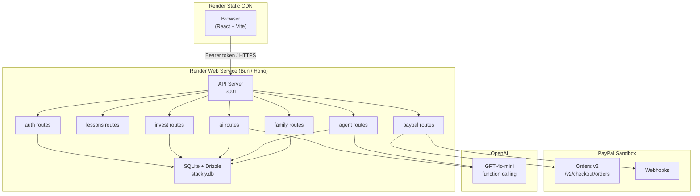

# Stackly — Money School for Kids

> A financial literacy platform that teaches children how PayPal works and how investing works, through age-adapted lessons, a paper-trading portfolio, and an AI coach that can propose real purchases for parent approval.

Built with [Arc Studio](https://studio.arc.io)

**Live demo:** https://stackly-web.onrender.com
**API health:** https://stackly-api.onrender.com/health

---

## Why it matters

Two-thirds of adults worldwide are financially illiterate. The habits and mental models that determine lifetime wealth are set before age 14. Stackly meets kids where they are — short lessons, age-appropriate language, a safe space to make mistakes with pretend money, and a real PayPal purchase flow (parent-gated) that makes the abstract concrete.

---

## Architecture



**Request flow for a Coach agent purchase:**
1. Learner types "help me start a lemonade stand" in the Coach
2. `POST /agent/run` — agent loop calls `list_kits`, selects the $5 Starter Kit, calls `create_purchase_request` (writes a `pending_agent` row; no PayPal call yet)
3. Parent sees the request in **Family → Approvals**, reads the plan timeline, approves
4. Server calls PayPal `POST /v2/checkout/orders` and returns a checkout URL
5. Parent completes PayPal checkout; webhook fires `CHECKOUT.ORDER.APPROVED`
6. Learner gets their Practice Dollars — no child ever touches a payment form

---

## Features

| Area | What's there |
|------|-------------|
| **Lessons** | 14 lessons × 3 reading levels (Sprouts / Builders / Investors), XP and streak tracking |
| **Paper trading** | Live-priced (synthetic CC0 data) buy/sell, portfolio donut, performance chart, Replay mode |
| **PayPal Lab** | 4 missions: send money, receive money, behind-the-scenes SSE, request money — all sandbox, parent-approved |
| **Coach (AI)** | Band-adapted chat, quiz, explain-a-concept, portfolio review; rate-limited, input/output moderated |
| **Coach Agent** | Agentic commerce: propose plan → pick kit → queue for parent approval; full audit log |
| **Family dashboard** | Weekly learner summary, approvals queue, spending cap, Coach toggle, reading level override, conversation starters, GDPR-style export and delete |
| **Security** | Zod validation, rate limits, CSP, HSTS, CORS, pre-commit secret scan, Playwright smoke tests |

---

## Local setup

### Prerequisites

- [Bun](https://bun.sh) ≥ 1.1
- A [PayPal sandbox](https://developer.paypal.com) app (free)
- An OpenAI API key (GPT-4o-mini is the default; see AI model swap below)

### Install and run

```bash
git clone https://github.com/Yinka101/Stackly
cd Stackly
bun install
```

Copy and fill the env file:

```bash
cp .env.example .env
# edit .env — see Environment variables below
```

Start both servers in one terminal:

```bash
bun run dev
# Vite frontend: http://localhost:5173
# Hono API:      http://localhost:3001
```

### Environment variables

| Variable | Required | Purpose |
|----------|----------|---------|
| `PAYPAL_CLIENT_ID` | Yes | PayPal sandbox app client ID |
| `PAYPAL_CLIENT_SECRET` | Yes | PayPal sandbox app client secret |
| `PAYPAL_ENV` | No | `sandbox` (default) or `live` |
| `PAYPAL_BASE_URL` | No | `https://api-m.sandbox.paypal.com` |
| `PAYPAL_WEBHOOK_ID` | No | Webhook ID for HMAC verification |
| `OPENAI_API_KEY` | Yes | LLM key; swap model with `COACH_MODEL` |
| `COACH_PROVIDER` | No | `openai` (default) |
| `COACH_MODEL` | No | `gpt-4o-mini` (default) |
| `COACH_BASE_URL` | No | Custom base URL (for OpenAI-compatible APIs) |
| `SESSION_SECRET` | Yes | 32+ random bytes for session signing |
| `DATABASE_URL` | No | SQLite path, default `./stackly.db` |
| `VITE_API_URL` | No | Absolute API URL in production; empty = Vite proxy |
| `DEMO_MODE` | No | `true` enables `POST /auth/demo-reset` |
| `VITE_DEMO_MODE` | No | `true` shows the Demo help drawer in the UI |

### AI model swap

Any OpenAI-compatible endpoint works:

```bash
COACH_PROVIDER=openai
COACH_MODEL=gpt-4o
COACH_BASE_URL=https://api.openai.com/v1  # or your proxy
```

### Run smoke tests

```bash
# Start both servers first, then:
bun run test:e2e
```

---

## Sandbox test credentials

> These credentials are seeded automatically on every server startup. No sign-up required.

### Parent account

| Field | Value |
|-------|-------|
| Email | `demo@stackly.app` |
| Password | `demo1234` |

### Learner PINs

| Learner | Band | PIN |
|---------|------|-----|
| Sam | Sprouts (7–10) | `1111` |
| Ben | Builders (11–14) | `2222` |
| Ivy | Investors (15–24) | `3333` |

### PayPal sandbox cards (use in PayPal checkout)

| Card | Number | Expiry | CVV |
|------|--------|--------|-----|
| Visa | `4032035105373942` | `01/2030` | `123` |
| Mastercard | `5425233430109903` | `02/2030` | `123` |

The **Demo** button (bottom-right of the live site) shows all credentials inline and lets you reset the demo family with one click.

> **⚠️ For judges:** The AI Coach and Agent features require `OPENAI_API_KEY` to be set on the `stackly-api` Render service. Without it the Coach falls back to offline canned answers and the Agent cannot call the LLM. Set it in the Render dashboard → `stackly-api` → Environment before testing. GPT-4o-mini is used by default — any OpenAI-compatible key works.

---

## AI tools used

| Tool / Model | Role |
|-------------|------|
| **GPT-4o-mini** (OpenAI) | Powers the Coach chat, quiz generator, concept explainer, portfolio reviewer, and the agentic commerce loop |
| **OpenAI function calling** | Agent loop: the model decides which tool to call (`list_kits`, `create_purchase_request`, `get_order_status`, `list_recent_activity`), max 6 rounds, result written to DB so the parent sees a readable plan timeline |
| **Arc Studio** | End-to-end development environment — designed all screens, wrote and audited all contract-adjacent server code, generated Playwright tests, and authored this submission |
| **System-prompt factory** | Band-specific prompts (Sprouts / Builders / Investors) with hard financial-advice prohibition and lexical constraints baked in |
| **Input/output moderator** | Strips PII patterns, blocks requests for advice on specific securities, and catches adversarial jailbreak attempts before they reach the model |

---

## Safety design

| Concern | Mitigation |
|---------|-----------|
| Kids and financial advice | Coach system prompt prohibits specific buy/sell recommendations; output moderator scans every response before delivery |
| Kids and payments | The agent can only _propose_; a parent must approve every PayPal order. Kids never see a payment form |
| Child data minimalism | Only nickname, age band, and avatar collected from learners. No email, location, or photo |
| Secrets | Never in client bundle or git. Zod validates every input. Pre-commit hook blocks accidental secret commits |
| Rate limiting | Auth: 10 req/min per IP. AI: 20 req/min per learner. Global: 120 req/min |
| Content Security Policy | PayPal sandbox domains explicitly allowlisted; `default-src 'self'` |
| Webhook integrity | HMAC-SHA256 verification on every PayPal webhook event; idempotency key deduplication |
| Agent least privilege | Tools can only read kits, create a queued request, and read status — no tool can directly execute a payment |

---

## Limitations

- **Ephemeral database** — SQLite on Render free tier is wiped on every redeploy. The demo family is re-seeded automatically but any user-created data is lost. A persistent disk (Render paid) or a hosted SQLite service (Turso) would fix this.
- **Cold starts** — Render free tier sleeps after 15 minutes of inactivity. An UptimeRobot monitor at `/health` every 5 minutes prevents this in practice.
- **Synthetic prices** — The investing screen uses CC0-licensed synthetic price data, not live market feeds, to avoid redistribution licence issues.
- **Single-region** — No CDN for the API; latency is higher for users far from Render's US East region.
- **No push notifications** — Parent approval alerts are pull-only (refresh the Approvals tab).

---

## Roadmap

1. **Persistent storage** — migrate to Turso (SQLite edge) or Postgres
2. **Push notifications** — WebSockets or SSE for real-time parent approval alerts
3. **Curriculum expansion** — budgeting, taxes, credit, compound interest modules
4. **Live price data** — opt-in delayed feed with explicit licensing
5. **Multi-language** — i18n for Spanish, French, Portuguese
6. **Accessibility audit** — full WCAG 2.2 AA certification
7. **Parental controls app** — dedicated parent mobile view with spending history
8. **School edition** — class codes, teacher dashboard, progress reports

---

## Screenshots to capture

For the Devpost submission, capture these 6 screenshots in order:

1. **Landing hero** — full-width, 1280px, showing the three age-band cards and the "Start free" CTA
2. **Lesson reader** — Ben (Builders) mid-lesson on "How PayPal moves money", showing the reading-level-adapted text and progress bar
3. **Paper trading** — Ivy's portfolio donut chart with the trade modal open, "Educational purposes only" disclaimer visible
4. **PayPal Lab — Behind the scenes** — the SSE event stream panel showing live PayPal API calls with decoded payloads
5. **Coach Agent plan timeline** — the step-by-step "Coach's plan" card after requesting a lemonade stand kit, showing tool calls and "Waiting for parent approval"
6. **Family approvals** — the parent's Approvals tab with the pending agent request, approve/decline buttons, and the audit log below

---

## Deploy to Render

`render.yaml` at the repo root defines both services. Connect the repo in the [Render dashboard](https://dashboard.render.com), choose "New Blueprint", and point it at this repository. Add the four secret env vars (`PAYPAL_CLIENT_ID`, `PAYPAL_CLIENT_SECRET`, `OPENAI_API_KEY`, `SESSION_SECRET`) in the Render dashboard — everything else is already in `render.yaml`.

---

## License

MIT — see [LICENSE](./LICENSE)
