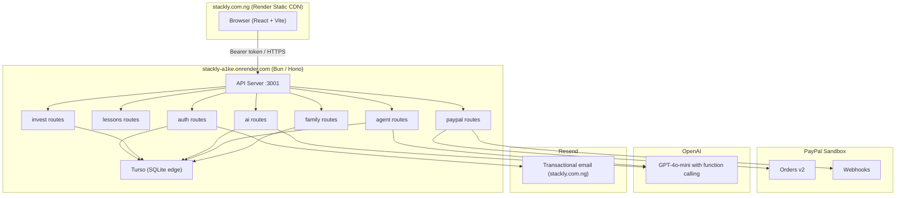

# Stackly - Money School for Kids

> A financial literacy platform that teaches children how PayPal works and how investing works, through age-adapted lessons, a paper-trading portfolio, and an AI coach that can propose real purchases for parent approval.


**Live site:** https://stackly.com.ng
**API health:** https://stackly-a1ke.onrender.com/health

---

## Why it matters

Two-thirds of adults worldwide are financially illiterate. The habits and mental models that determine lifetime wealth are set before age 14. Stackly meets kids where they are: short lessons, age-appropriate language, a safe space to make mistakes with pretend money, and a real PayPal purchase flow (parent-gated) that makes the abstract concrete.

---

## Architecture



**Agent purchase flow:**
1. Learner types "help me start a lemonade stand" in the Coach
2. `POST /agent/run` runs the agent loop, calls `list_kits`, selects the Starter Kit, calls `create_purchase_request` (writes a `pending_agent` row)
3. Parent sees the request in **Family - Approvals**, reads the plan, approves
4. Server calls PayPal `POST /v2/checkout/orders` to create the order record
5. Learner clicks "Complete Practice Checkout" - server runs simulated capture, awards Practice Dollars instantly
6. No real money moves, no PayPal login required - teaches the full lifecycle safely

---

## Features

| Area | What's there |
|------|-------------|
| **Lessons** | 14 lessons x 3 reading levels (Sprouts / Builders / Investors), XP and streak tracking |
| **Paper trading** | Synthetic CC0 price data, buy/sell with reflections, portfolio donut, performance chart, Time Replay mode |
| **PayPal Lab** | 4 missions: send money, request money, simulated checkout (full Orders v2 lifecycle, no real PayPal login needed, no real money moves), spot the scam game |
| **Coach (Penny)** | Band-adapted chat, quiz, concept explainer, portfolio review; rate-limited per bucket, input/output moderated |
| **Coach Agent** | Agentic commerce: propose plan, pick kit, queue for parent approval, full audit log |
| **Family dashboard** | Weekly learner summary, approvals queue, spending cap, Coach toggle, reading level override, conversation starters, GDPR-style export and delete |
| **Auth and email** | Parent registration, login, forgot-password reset, welcome email - all via Resend from noreply@stackly.com.ng |
| **Persistent DB** | Turso (hosted SQLite edge) - data survives every Render redeploy permanently |

---

## Local setup

### Prerequisites

- [Bun](https://bun.sh) >= 1.1
- A [PayPal sandbox](https://developer.paypal.com) app (free)
- An [OpenAI API key](https://platform.openai.com) (GPT-4o-mini is the default)
- A [Resend](https://resend.com) API key (free tier, for emails)

### Install and run

```bash
git clone https://github.com/Yinka101/Stackly
cd Stackly
bun install
```

Copy and fill the env file:

```bash
cp .env.example .env
# edit .env with your keys
```

Start both servers:

```bash
bun run dev
# Vite frontend: http://localhost:5173
# Hono API:      http://localhost:3001
```

### Environment variables

| Variable | Required | Purpose |
|----------|----------|---------|
| `PAYPAL_CLIENT_ID` | Yes | PayPal sandbox app client ID |
| `PAYPAL_CLIENT_SECRET` | Yes | PayPal sandbox app client secret |
| `PAYPAL_ENV` | No | `sandbox` (default) or `live` |
| `PAYPAL_BASE_URL` | No | `https://api-m.sandbox.paypal.com` (default) |
| `PAYPAL_WEBHOOK_ID` | No | Webhook ID for HMAC verification |
| `OPENAI_API_KEY` | Yes | Powers Coach chat, quiz, agent loop |
| `COACH_PROVIDER` | No | `openai` (default) |
| `COACH_MODEL` | No | `gpt-4o-mini` (default) |
| `COACH_BASE_URL` | No | Custom base URL for OpenAI-compatible APIs |
| `SESSION_SECRET` | Yes | 32+ random bytes for session signing |
| `TURSO_DATABASE_URL` | No | `libsql://...turso.io` - if absent falls back to local SQLite |
| `TURSO_AUTH_TOKEN` | No | Turso auth token - required when `TURSO_DATABASE_URL` is set |
| `DATABASE_URL` | No | Local SQLite path, default `./stackly.db` |
| `RESEND_API_KEY` | No | Sends welcome and password reset emails |
| `APP_URL` | No | Base URL for email links, default `https://stackly.com.ng` |
| `VITE_API_URL` | No | Absolute API URL in production; empty string uses Vite proxy locally |
| `DEMO_MODE` | No | `true` enables `POST /auth/demo-reset` |
| `VITE_DEMO_MODE` | No | `true` shows the Demo help drawer in the UI |
| `CORS_ORIGIN` | No | Comma-separated allowed origins; all `*.onrender.com` and `stackly.com.ng` are always allowed |

### AI model swap

Any OpenAI-compatible endpoint works:

```bash
COACH_PROVIDER=openai
COACH_MODEL=gpt-4o
COACH_BASE_URL=https://api.openai.com/v1
```

---

## Sandbox test credentials

> Seeded automatically on every server startup. No sign-up required.

### Parent account

| Field | Value |
|-------|-------|
| Email | `demo@stackly.app` |
| Password | `demo1234` |

### Learner PINs

| Learner | Band | PIN |
|---------|------|-----|
| Sam | Sprouts (7-10) | `1111` |
| Ben | Builders (11-14) | `2222` |
| Ivy | Investors (15-24) | `3333` |

> **For judges:** The AI Coach and Agent require `OPENAI_API_KEY` to be set on the `stackly-api` Render service. Without it the Coach falls back to offline keyword-matched answers and the Agent cannot call the LLM. Set it in Render dashboard - stackly-api - Environment. GPT-4o-mini is the default.
>
> Mission 3 (Pay at a Checkout) uses a simulated capture - no PayPal login is needed and no real money moves. Complete the checkout by clicking "Complete Practice Checkout" after parent approval.

---

## AI tools used

| Tool / Model | Role |
|-------------|------|
| **GPT-4o-mini** (OpenAI) | Powers Coach chat, quiz generator, concept explainer, portfolio reviewer, and the agentic commerce loop |
| **OpenAI function calling** | Agent loop: model decides which tool to call (`list_kits`, `create_purchase_request`, `get_order_status`, `list_recent_activity`), max 6 rounds, result written to DB so the parent sees a readable plan timeline |
| **System-prompt factory** | Band-specific prompts (Sprouts / Builders / Investors) with hard financial-advice prohibition and lexical constraints baked in |
| **Input/output moderator** | Strips PII patterns, blocks requests for advice on specific securities, and catches adversarial jailbreak attempts before they reach the model |

---

## Safety design

| Concern | Mitigation |
|---------|-----------|
| Kids and financial advice | Coach system prompt prohibits specific buy/sell recommendations; output moderator scans every response before delivery |
| Kids and payments | The agent can only propose; a parent must approve every PayPal order. Kids never see a payment form |
| Child data minimalism | Only nickname, age band, and avatar collected from learners. No email, location, or photo |
| Secrets | Never in client bundle or git. Zod validates every input. Pre-commit hook blocks accidental secret commits |
| Rate limiting | Auth: 10 req/min per IP. Chat: 60/min per learner. Agent: 15/min per learner. Quiz: 20/min. Review: 10/min |
| Content Security Policy | PayPal sandbox domains explicitly allowlisted; `default-src 'self'` |
| Webhook integrity | HMAC-SHA256 verification on every PayPal webhook event; idempotency key deduplication |
| Agent least privilege | Tools can only read kits, create a queued request, and read status - no tool can directly execute a payment |

---

## Deployment

The app runs as a single Hono service (`stackly-api`) that builds the Vite frontend and serves it from `dist/`. A separate Render static site (`stackly-web`) at `stackly.com.ng` also serves the built frontend.

**Database:** Turso (hosted SQLite edge) - data persists across every Render redeploy. Falls back to local SQLite when `TURSO_DATABASE_URL` is not set (local dev).

**Email:** Resend with verified domain `stackly.com.ng`. Sends welcome emails on registration and password reset links.

To deploy your own instance:
1. Fork the repo
2. Connect to [Render](https://dashboard.render.com) via New Blueprint pointing at your fork
3. Set the secret env vars in the Render dashboard (`PAYPAL_CLIENT_ID`, `PAYPAL_CLIENT_SECRET`, `OPENAI_API_KEY`, `SESSION_SECRET`, `TURSO_DATABASE_URL`, `TURSO_AUTH_TOKEN`, `RESEND_API_KEY`)
4. Update the build command in Render Settings to:
   ```
   curl -fsSL https://bun.sh/install | bash && $HOME/.bun/bin/bun install --no-frozen-lockfile && VITE_API_URL="" VITE_DEMO_MODE=true $HOME/.bun/bin/bun x vite build
   ```

---

## Roadmap

1. Push notifications for real-time parent approval alerts
2. Curriculum expansion - budgeting, taxes, credit scores, compound interest
3. Live (delayed) price data with explicit CC0 licensing
4. Multi-language support starting with Yoruba, Igbo, and Pidgin
5. School edition - class codes, teacher dashboard, progress reports
6. Mobile app for the parent approval flow
7. Accessibility audit - full WCAG 2.2 AA certification

---

## License

MIT - see [LICENSE](./LICENSE)
